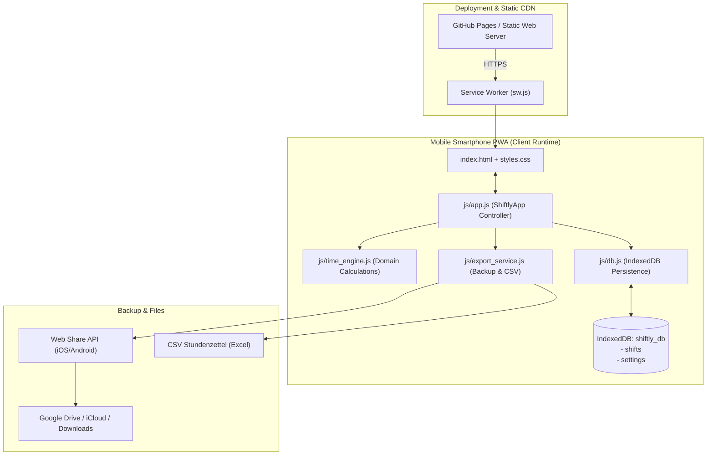

# Systemarchitektur · Shiftly 📱⏱️

> **Zweck dieses Dokuments:** Dieses Dokument beschreibt die ganzheitliche Systemarchitektur, Schichten, Datenflüsse und Laufzeitumgebung von *Shiftly*. Es dient Entwicklern und KI-Agenten als systematisches Fundament für Erweiterungen und Refactorings.
>
> 💡 *Für gezielte, token-sparende Code-Navigation bei Umbauten:* Siehe [docs/AI_INDEX.md](file:///d:/Dev/Shiftly/docs/AI_INDEX.md).

---

## 1. Architektur-Prinzipien & Philosophie

1. **100 % Standalone & Offline-First (Zero Cloud / Zero Backend Dependency):**
   - Keine Pflicht für laufende externe Server, Docker-Container oder API-Backends.
   - Alle Schichten laufen nativ im Browser des Smartphones (iOS Safari / Android Chrome).
   - Die Persistenzschicht (`IndexedDB`) sichert Daten direkt auf dem Dateisystem des Mobilgeräts mit explizitem `navigator.storage.persist()`-Schutz.

2. **Zero-Build Frontend Architecture:**
   - Reines modernes Vanilla JavaScript (ES6+ Modules), HTML5 und CSS3.
   - Kein Node.js, kein NPM, kein Webpack, Vite oder Babel.
   - Läuft ohne Buildschritt direkt von GitHub Pages oder lokalem Python `http.server`.

3. **Klare Schichtentrennung:**
   - **Presentation Layer:** `index.html`, `styles.css` und `js/app.js` (State, Modals, DOM).
   - **Domain & Calculation Engine:** `js/time_engine.js` (Reine Mathematik: Schichtdauern, Pausen, Minijob-Grenzen, Stundensätze).
   - **Persistence Layer:** `js/db.js` (IndexedDB Wrapper mit Promises und Transaktionssicherheit).
   - **Export & Backup Service:** `js/export_service.js` (Web Share API, JSON-Backup/Restore, CSV-Export, Druckansicht).
   - **Offline & Cache Layer:** `sw.js` (Service Worker mit Stale-While-Revalidate Caching).

---

## 2. System-Übersichtsdiagramm

---

## 3. Schichten & Modul-Verantwortlichkeiten

- **`js/db.js`:** Kapselt IndexedDB Transaktionen (`shifts`, `settings`). Garantiert deterministische IDs und Schema-Upgrades.
- **`js/time_engine.js`:** Isolierte Berechnung von Netto-Stunden (inkl. Nachtschichten über Mitternacht), Verdienst und Minijob-Deckelung.
- **`js/export_service.js`:** Datensicherung via `navigator.share` (direkt in Google Drive oder Dateimanager des Handys) sowie CSV-Generierung mit UTF-8 BOM für Microsoft Excel.
- **`js/app.js`:** Orchestriert UI, Monatsnavigation, Modals und Event-Handler.

